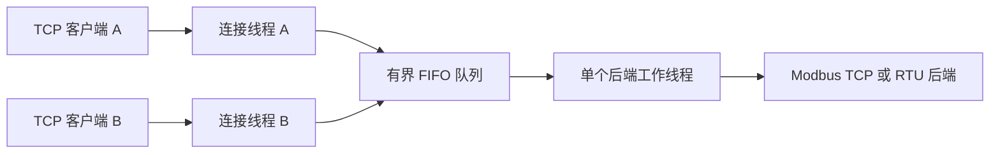

# 网关架构

## 请求生命周期

1. 主线程使用 `poll()` 监听接入、退出信号和连接完成事件。每条接入连接由一个线程处理。常规构建接入两条连接后关闭监听套接字。
2. 连接线程通过 `modbus_receive()` 接收一条请求，将独立报文缓冲区、前端上下文和完成条件变量放入任务。队列用互斥锁保护入队、出队和完成状态。任务在连接线程的栈上，连接线程等待完成后才释放任务和前端上下文。
3. 后端工作线程按入队顺序取出任务，并在释放队列锁后调用 `modbus_proxy()`。同一个后端上下文由这一个工作线程使用，后端收发和前端回复均在锁外完成。
4. 工作线程将任务标记为完成并唤醒连接线程。连接线程在队列锁内关闭自己的套接字并将描述符标为无效，再通过 `eventfd` 通知主线程。

核心实现见 [gateway_shared_backend_demo.c](../src/gateway_shared_backend_demo.c) 中的 `serve_client()`、`submit_and_wait()`、`backend_worker()` 和 `run_gateway()`。

## 排队与超时

- 等待槽位满时，连接线程立即回复 Modbus 忙异常 `0x06`。
- 启用排队期限后，工作线程出队时检查等待时间。达到期限的任务回复 `0x06` 并结束，后端收不到这条请求。
- 后端响应超时由 libmodbus 控制。设备返回的 Modbus 异常成功转发时计为转发完成。

转发日志中的「排队」是从入队到出队的时间，「转发」是 `modbus_proxy()` 调用的时间，包含后端收发与前端回复。客户端观察到的往返时间还包含前端收包和调度。

## 停止与回收

主线程通过 `signalfd` 接收 `SIGINT` 和 `SIGTERM`。停止时先关闭监听套接字，再取消队列里尚未取出的任务，唤醒等待线程，并对仍有效的前端套接字执行 `shutdown()`。

已出队的任务由后端线程按现有 I/O 超时继续处理，连接线程等任务完成后关闭自己的描述符。主线程等待连接线程和工作线程退出，再释放同步对象与通知描述符。
