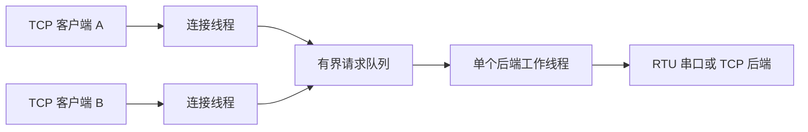

# ModbusGateway 工程验收与复盘

日期 2026-11-06。环境为 WSL Ubuntu 24.04、GCC 13.3、CMake 3.28.3、libmodbus 3.2.0 和 Python 3.12。用户亲手完成了正常 RTU 读写、两种超时恢复和非法寄存器写入联调。此文的工程回归、sanitizer 与基准由助手代跑。

## 构建与复现

```bash
cmake -S . -B build-cmake -DCMAKE_BUILD_TYPE=RelWithDebInfo
cmake --build build-cmake -j
ctest --test-dir build-cmake --output-on-failure
GATEWAY_FOUR_CLIENTS="$PWD/build-cmake/gateway_four_clients" \
  python3 -B tests/gateway_benchmark.py --rounds 25
```

本机使用用户目录下的 `~/.local/bin/cmake` 和 `~/.local/bin/ctest`。现有 Makefile 也可构建项目。完整配置字段见 [README](../README.md)。

## 验收结果

| 范围 | 输入与实际结果 | 入口 |
|---|---|---|
| 启动配置 | 自定义前后端 IPv4 与端口、队列容量及期限生效。RTU 按 19200 8N2 启动，已读取虚拟串口的两位停止位设置。验证位置参数优先级，10 项非法设置均报告字段并以 1 退出 | [网关配置](../gateway_shared_backend_demo.c) · [系统回归](../tests/gateway_system_demo.py) |
| 功能 | TCP 请求分成两段发送仍可写入。B 读回 123、999、789。两个模拟 RTU 设备的 Unit ID 分别读回 123、456。非法地址回复 0x02，合法请求仍可读 | [系统回归](../tests/gateway_system_demo.py) |
| 异常 | 设备地址缺失与设备沉默均回复 0x0B，下一条合法请求可读。TCP 后端断开时网关回 0x0A。重启网关和后端后恢复 | [系统回归](../tests/gateway_system_demo.py) |
| 容量 | 单等待槽位只接受一个等待者，其他连接收到 0x06。出队时发现写请求过期，返回 0x06，后端下一帧为新读请求 | [队列回归](../tests/gateway_capacity_demo.py) |
| 生命周期 | 在途断连、FD 复用、SIGINT/SIGTERM、退出取消排队写入、端口重开均通过。首个连接完成后，FD 和线程数从 /proc 观察到回归基线 | [断连回归](../tests/gateway_disconnect_demo.py) · [退出回归](../tests/gateway_shutdown_demo.py) · [系统回归](../tests/gateway_system_demo.py) |
| 教学版连接边界 | 同一 TCP 连接处理一条请求后关闭。系统回归尝试再发一条写请求，连接关闭且 B 读到的值未被改变 | [系统回归](../tests/gateway_system_demo.py) |

CMake 的五项 CTest 连续运行五轮全部通过。ASan、UBSan 和泄漏检查构建复跑同一套 CTest，五项均通过。sanitizer 覆盖本项目的编译目标，预装的 libmodbus 静态库沿用普通构建。线程正确性主要通过同步规则审查和并发回归检查。

```bash
san_dir=$(mktemp -d /tmp/modbus-gateway-sanitizers.XXXXXX)
cmake -S . -B "$san_dir" -DCMAKE_BUILD_TYPE=Debug \
  '-DCMAKE_C_FLAGS=-fsanitize=address,undefined -fno-omit-frame-pointer -fno-pie' \
  '-DCMAKE_EXE_LINKER_FLAGS=-fsanitize=address,undefined -no-pie'
cmake --build "$san_dir" -j
ASAN_OPTIONS=detect_leaks=1:halt_on_error=1 UBSAN_OPTIONS=halt_on_error=1 \
  ctest --test-dir "$san_dir" --output-on-failure
```

### 联调发现的一个竞争

客户端 `connect()` 成功时，网关线程可能还没有调用 `accept()`。断连用例原本立即断开 A，并断言 B 一定拿到不同的 FD。重复运行复现了 B 复用 A 的 FD。回归现在等 B 的“已接入”日志后再断开 A，使“B 已被接入”和“连接复用 FD”成为两个有明确前置条件的场景。

## 性能测量

每种方式 25 轮，每轮四条独立 TCP 连接，总计 100 条 `0x03` 读请求。走 TCP→网关→虚拟 RTU 链路，Python 模拟设备在每次回复前等待 20 ms。后端响应超时为 500 ms，队列容量为 4，关闭排队过期。吞吐按各轮从开始发送到收齐回复的时间相加计算，启动、连接建立和退出不计入。

| 发送方式 | 请求/秒 | 客户端 RTT P50 | 客户端 RTT P95 | 排队 P50 / 最大值 | 转发 P50 |
|---|---:|---:|---:|---:|---:|
| 逐条发送 | 46.5 | 21.6 ms | 21.9 ms | 0.0 / 1 ms | 21.0 ms |
| 四条并发 | 47.2 | 52.7 ms | 85.5 ms | 31.5 / 64 ms | 21.0 ms |

并发时后端仍由一个线程顺序处理，设备处理时间近似相同，排队拉长了客户端尾延迟。这组数字适用于上述虚拟串口和人工延时场景。真实 RS-485 设备的时序、接线、电气干扰与负载需要现场测量。

## 需要掌握的内容

| 单元 | 读哪段代码 | 能讲清楚什么 |
|---|---|---|
| 21 | 网关的 `gateway_config`、`load_config()` 和 `main()` | 配置的默认值、环境变量和位置参数优先级；为什么要在建连接前校验 |
| 25 | `CMakeLists.txt` 的 `add_executable()`、`PkgConfig::MODBUS`、`Threads::Threads` 和 `add_test()` | 配置、编译、链接与运行测试各在哪一步发生 |
| 26～27 | `gateway_system_demo.py` 与三个回归脚本 | TCP 分段接收、后端异常与网关超时的区别、可控测试后端如何复现故障 |
| 28 | `client_worker()`、`stop_gateway()`、`pthread_join()` 和 /proc 检查 | 谁拥有 FD，什么时机可以释放任务，如何验证线程和 FD 回收 |
| 29 | `gateway_benchmark.py` 与网关计时 | P50/P95、吞吐、排队和转发耗时分别是什么，为什么并发不一定增加单串口吞吐 |
| 30 | 下方讲解提纲 | 需求、架构、一个实际故障和证据、工程边界 |

## 3～5 分钟项目讲解



1. **需求，约 30 秒。** 做一个 Linux C 网关，让多个 Modbus TCP 客户端共享一个 RTU 后端。说出自己跑过的例子，A 写入 999，B 从另一条连接读回 123、999、789。
2. **架构，约 1 分钟。** 前端每连接一个线程，提交带独立缓冲区的任务。队列在锁内入队和出队，串口等待在锁外，只有后端线程操作后端上下文。任务用完才唤醒连接线程清理。
3. **故障，约 1 分钟。** 用自己的两次单元 19 结果说明 0x0B 无法区分设备地址不存在和设备收到后沉默；从站日志能区分。再用非法寄存器地址返回的 0x02 对照设备明确拒绝的情况。
4. **取舍和证据，约 1 分钟。** 用代跑数据说明为什么把排队耗时与转发耗时分开。说明队满、过期和关闭时都如何保护等待中的任务。把助手新增代码与自己亲手联调的结果分别描述。
5. **当前边界，约 30 秒。** 这是定额接入、每连接一条请求的 Linux 教学版。TCP 后端恢复依赖进程重启。真实 RS-485、长期运行和高负载客户端属于独立验收场景。

现场定位时先看设备是否收到请求，再看有无有效回复和回复时序，最后结合入队、出队和转发日志判断瓶颈。遇到写入确认丢失，先核实设备状态，避免盲目重发。
